<div align="center">

🌐 [English](README.md) · **Bahasa Indonesia**


# Rekamind

**Rekam rapat. Dapatkan transkrip per pembicara, ringkasan, dan daftar task. Data tetap milik Anda.**

[](https://github.com/handokoaji/rekamind/releases/tag/v0.4.0-beta.5)
[](#-unduh)
[](LICENSE)

[**Unduh**](#-unduh) · [Panduan mulai](#-panduan-dari-pemasangan-sampai-terpakai) · [Fitur](#-fitur) · [Server tim](#-server-bersama-untuk-tim) · [Masalah umum](#-masalah-umum)

<br>

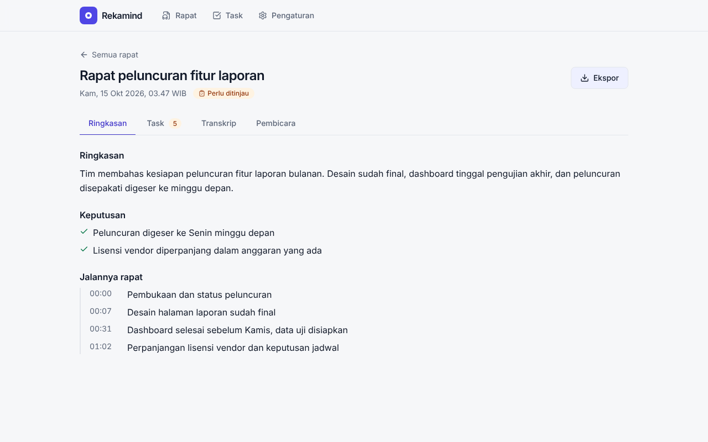

</div>

> [!WARNING]
> **Ini rilis beta (0.x; terbaru: v0.4.0-beta.5) untuk diuji, bukan rilis final.** Fungsi utama sudah diuji otomatis dan
> dicoba langsung di tiga PC Windows (satu NVIDIA, satu Intel, satu AMD), tetapi belum di banyak mesin. Aplikasi desktop
> Linux **belum** diuji di perangkat keras nyata. **Jangan jadikan Rekamind satu-satunya salinan rekaman yang penting.**
> Daftar batasan yang jujur ada di [Batasan rilis beta](#-batasan-rilis-beta).

> [!NOTE]
> **Bahasa:** antarmuka tersedia dalam **Indonesia (bawaan) dan Inggris**; ganti lewat pemilih bahasa di bilah atas (juga ada di layar masuk).
> Ringkasan, keputusan, dan task yang dihasilkan saat ini **hanya berbahasa Indonesia**, apa pun bahasa antarmukanya.

## Kenapa Rekamind

- **Ringan saat merekam.** Perekam kecil (Rust) yang menangkap mikrofon dan suara sistem. Tidak ada model AI yang
  berjalan selama rapat; jendela boleh ditutup.
- **Lokal dulu.** Transkripsi (Whisper) dan pemisahan pembicara berjalan di komputer Anda. Hanya teks transkrip
  yang dikirim ke layanan ringkasan pilihan Anda, dan itu opsional.
- **Dari rekaman jadi pekerjaan.** Hasilnya bukan hanya teks: ada keputusan, jalannya rapat, dan **task** lengkap
  dengan PIC, tenggat, dan kutipan bukti yang bisa diputar ulang.
- **Satu orang atau satu tim.** Pasang di laptop sendiri, atau di server kantor dengan login Google.
- **Terbuka.** Berlisensi AGPL-3.0-or-later. Tidak ada akun, telemetri, atau kredensial bawaan.

## ✨ Fitur

<table>
<tr>
<td width="50%" valign="top">

### Rekam dari desktop
Satu tombol atau `Ctrl+Alt+R`. Merekam mikrofon + suara rapat (Zoom, Meet, Teams, dll.) ke dua jalur terpisah,
jadi pembicara lokal dan peserta jarak jauh mudah dibedakan.

</td>
<td width="50%" valign="top">

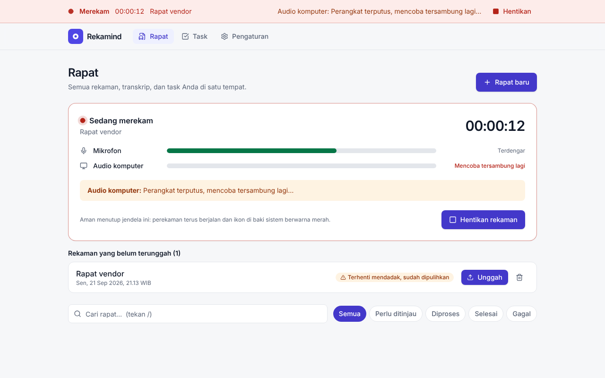

</td>
</tr>
<tr>
<td width="50%" valign="top">

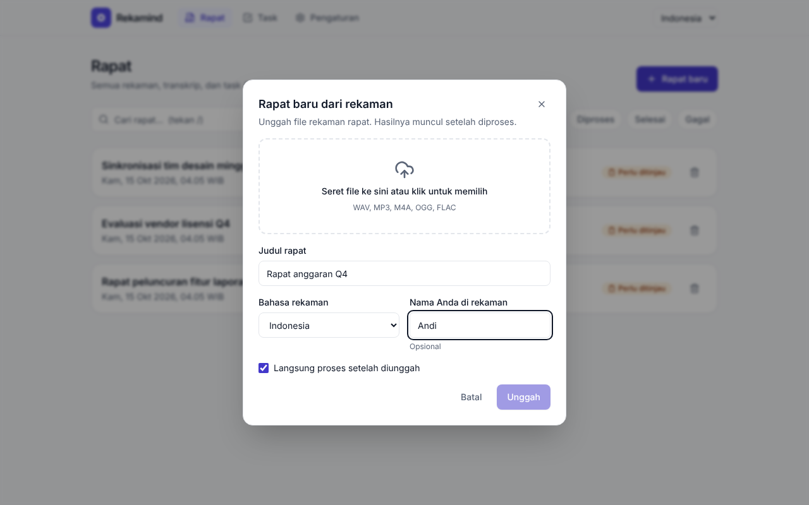

</td>
<td width="50%" valign="top">

### Atau unggah rekaman
Sudah punya rekaman? Unggah WAV, MP3, atau M4A. Judul diisi otomatis dari nama berkas.

</td>
</tr>
<tr>
<td width="50%" valign="top">

### Ringkasan, keputusan, jalannya rapat
Dibuat dari transkrip lengkap, dalam Bahasa Indonesia. Rapat panjang dipecah otomatis bila layanan ringkasan
membatasi ukuran.

</td>
<td width="50%" valign="top">

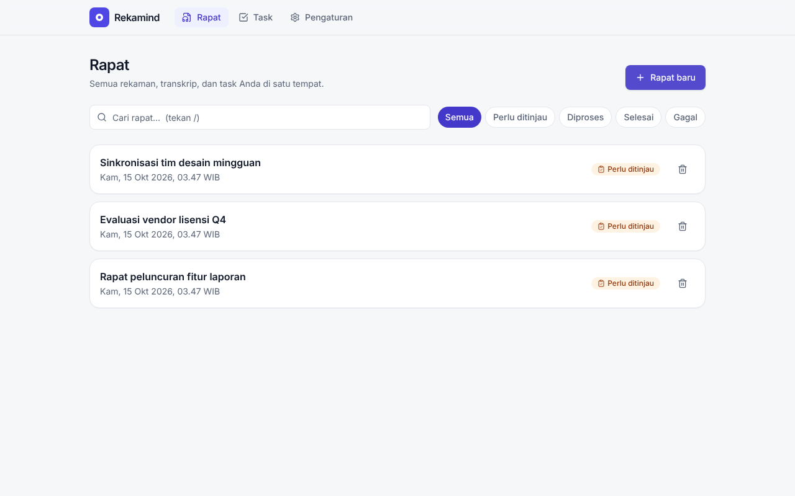

</td>
</tr>
<tr>
<td width="50%" valign="top">

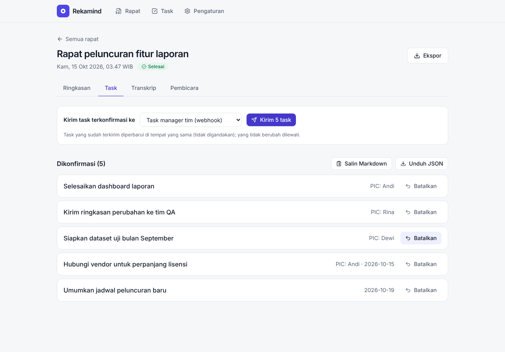

</td>
<td width="50%" valign="top">

### Task yang bisa Anda periksa
Setiap task membawa PIC, tenggat, estimasi, dan **kutipan bukti**. Anda meninjau dan mengonfirmasi dulu; tidak
ada yang dikirim ke mana pun sebelum Anda memutuskan.

</td>
</tr>
<tr>
<td width="50%" valign="top">

### Transkrip per pembicara
Mikrofon dan suara sistem dipisah, lalu pembicara dikenali dan bisa Anda beri nama. Kalimat yang diucapkan dua orang
dipotong di titik pergantian suara. Bila aplikasi menggabungkan suara yang mirip, beri tahu jumlah orangnya lalu pisahkan
ulang. Transkrip panjang tetap mulus (daftar virtual). Setiap rekaman bisa diputar ulang dari halaman rapat.

</td>
<td width="50%" valign="top">

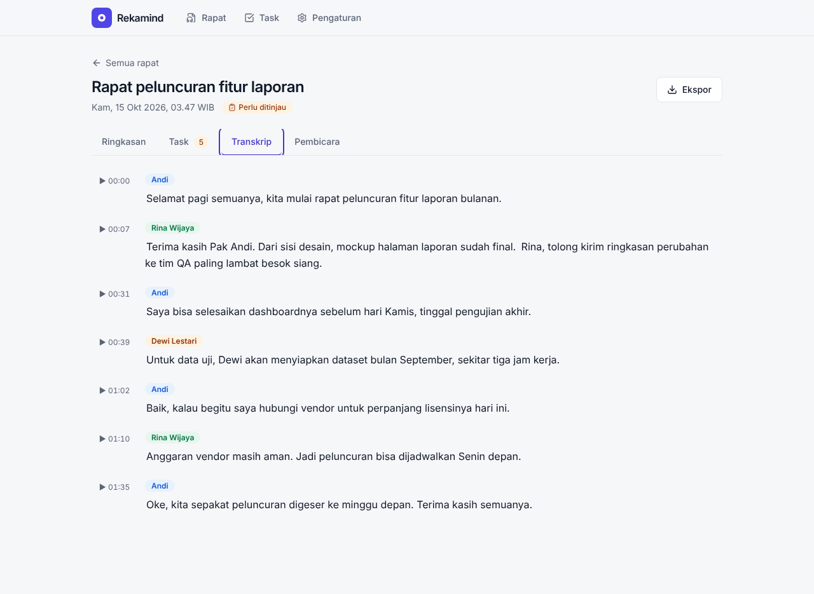

</td>
</tr>
<tr>
<td width="50%" valign="top">

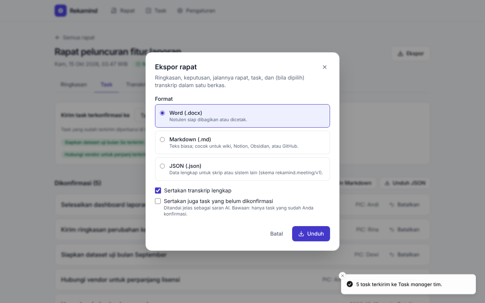

</td>
<td width="50%" valign="top">

### Ekspor lengkap
Satu berkas berisi ringkasan, keputusan, task, dan (opsional) transkrip: **Word (.docx)**, **Markdown**, atau
**JSON**. Waktu memakai zona waktu pilihan Anda (bawaan WIB).

</td>
</tr>
<tr>
<td width="50%" valign="top">

### Kirim task ke tempat kerja Anda
**GitHub Issues**, **GitLab Issues**, atau **webhook** bertanda tangan (HMAC) untuk task manager apa pun.
Mengirim dua kali tidak membuat duplikat.

</td>
<td width="50%" valign="top">

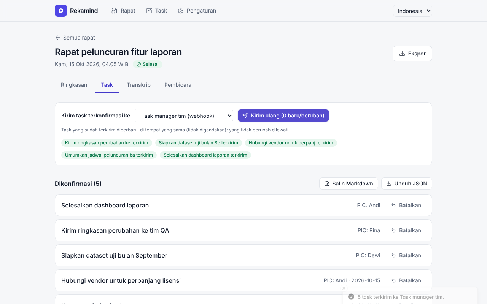

</td>
</tr>
</table>

<details>
<summary><b>Lebih banyak tampilan</b> (pembicara, semua task, pengaturan, mode gelap, login)</summary>
<br>

| | |
|---|---|
| 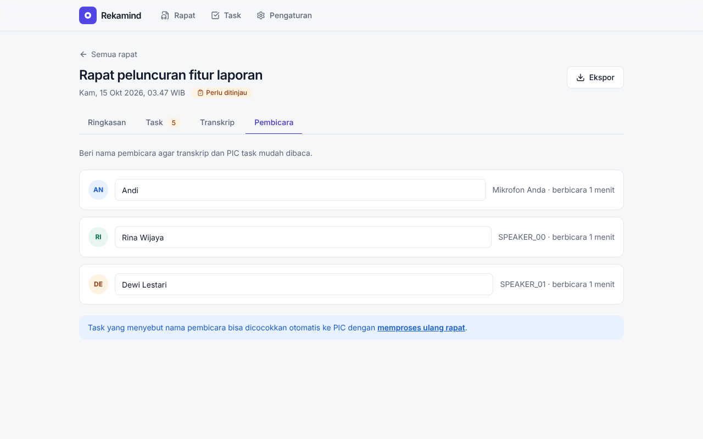 <br> **Beri nama pembicara** | 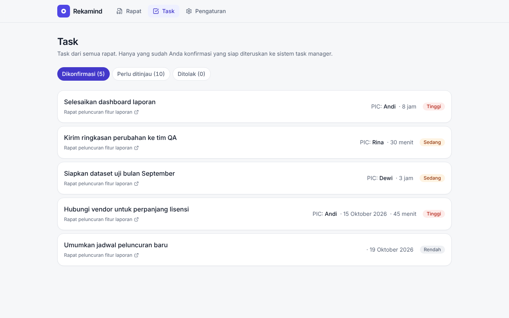 <br> **Semua task lintas rapat** |
| 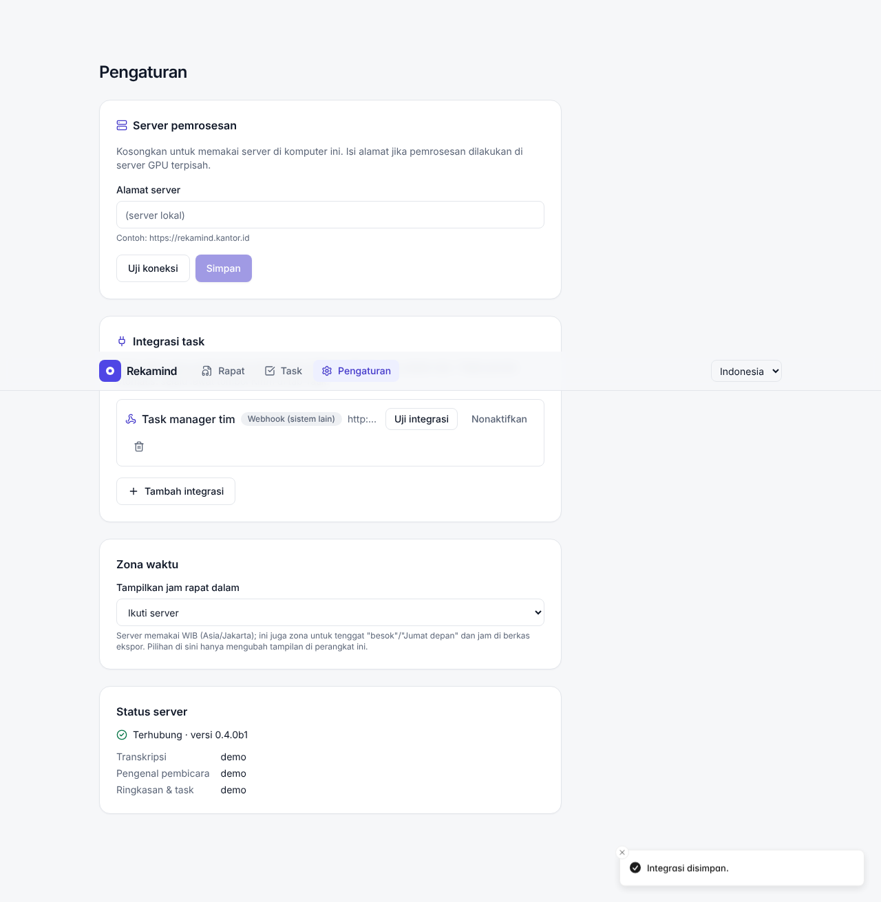 <br> **Pengaturan: integrasi dan zona waktu** | 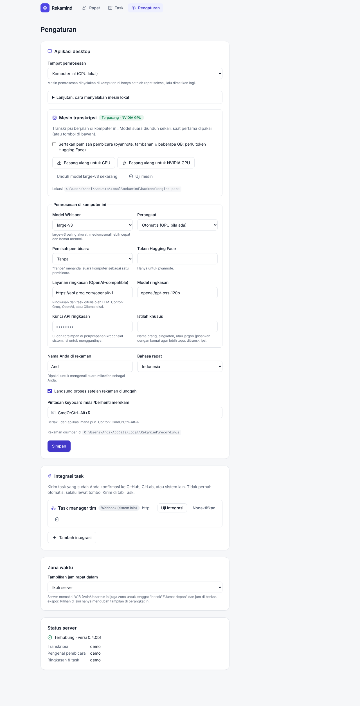 <br> **Pengaturan desktop: pasang mesin lokal** |
| 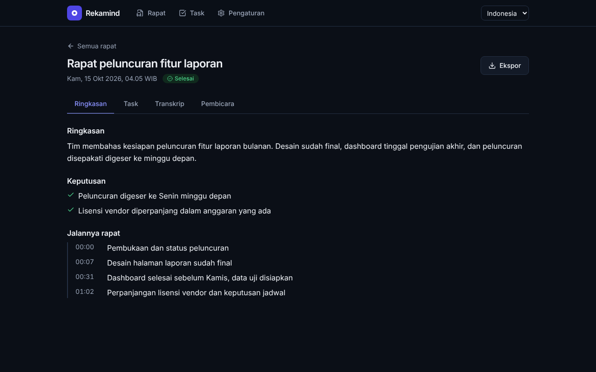 <br> **Mode gelap otomatis** | 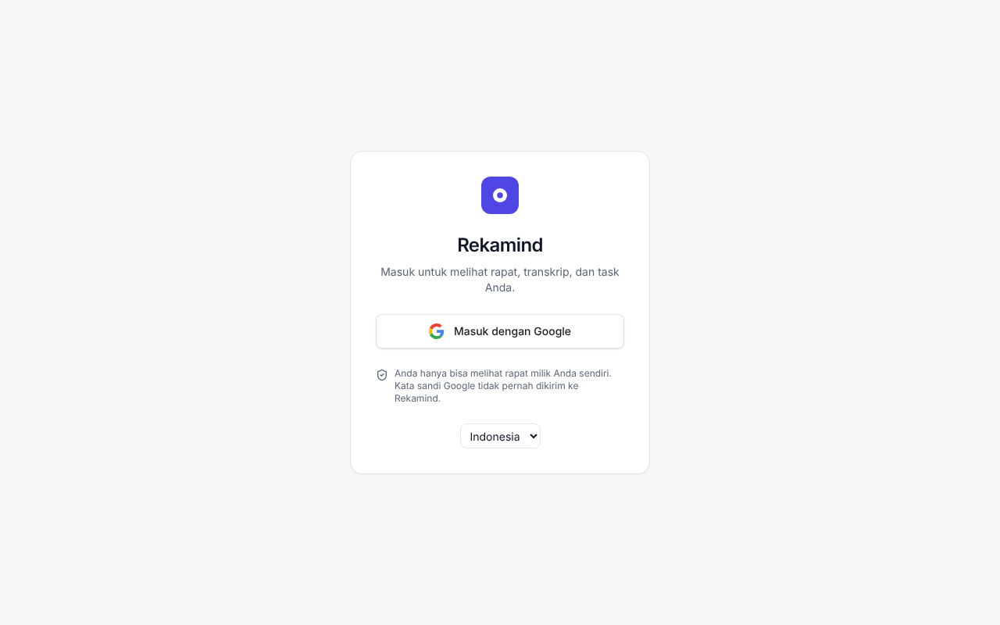 <br> **Login Google (mode server)** |

</details>

> Screenshot dibuat dari aplikasi sungguhan dengan isi rapat contoh (mesin "demo"), bukan hasil model asli.
> Kualitas transkrip dan ringkasan Anda bergantung pada audio, model, dan layanan ringkasan yang dipakai.

## 📥 Unduh

Buka halaman rilis dan pilih berkas sesuai sistem Anda:

| Sistem | Berkas | Catatan |
|---|---|---|
| **Windows 10/11 (64-bit)** | [`Rekamind-Windows-x64-setup.exe`](https://github.com/handokoaji/rekamind/releases/download/v0.4.0-beta.5/Rekamind-Windows-x64-setup.exe) | Pemasang `.exe`. Tanpa hak admin. |
| **Linux (64-bit)** | [`Rekamind-Linux-x64.deb`](https://github.com/handokoaji/rekamind/releases/download/v0.4.0-beta.5/Rekamind-Linux-x64.deb) | Debian/Ubuntu dan turunannya. |
| Linux, distro lain | `Rekamind-Linux-x64.AppImage` | **Belum tersedia di beta.2** (build AppImage gagal; perbaikan direncanakan). Pakai `.deb`. |

Semua berkas disertai `SHA256SUMS.txt`. Semua halaman rilis: [Releases](https://github.com/handokoaji/rekamind/releases).

**Installer belum bertanda tangan digital** (rilis beta). Windows SmartScreen akan menampilkan "Windows protected
your PC": klik **More info → Run anyway**. Itu perilaku normal untuk aplikasi tanpa sertifikat berbayar; bandingkan
checksum bila ragu.

## 🚀 Panduan: dari pemasangan sampai terpakai

Sekitar 15 menit, sebagian besar menunggu unduhan sekali saja.

### Langkah 1: Pasang aplikasi

<details open>
<summary><b>Windows</b></summary>

1. Unduh `Rekamind-Windows-x64-setup.exe`, jalankan.
2. Bila SmartScreen muncul: **More info → Run anyway**.
3. Ikuti pemasang (bahasa Indonesia tersedia). Rekamind terpasang untuk pengguna Anda saja, tanpa hak admin.
4. Buka **Rekamind** dari Start Menu.

Syarat: Windows 10/11 64-bit. WebView2 sudah bawaan Windows 11 dan terpasang otomatis bila belum ada.

</details>

<details>
<summary><b>Linux (Debian / Ubuntu)</b></summary>

```bash
sudo apt install ./Rekamind-Linux-x64.deb      # menarik juga pulseaudio-utils dan WebKitGTK
rekamind                                        # atau buka dari menu aplikasi
```

Perekaman memakai PulseAudio atau PipeWire (lewat `parec`). Di sistem PipeWire, pastikan paket `pipewire-pulse`
terpasang (bawaan di Ubuntu 22.10+ dan Fedora). Untuk AppImage: `chmod +x Rekamind-Linux-x64.AppImage` lalu jalankan.

</details>

### Langkah 2: Coba merekam

1. Di halaman **Rapat**, ketik judul lalu klik **Mulai merekam**, atau tekan `Ctrl+Alt+R` dari aplikasi mana pun.
2. Rapat berjalan seperti biasa. Jendela Rekamind boleh ditutup; perekam tetap berjalan di baki sistem.
3. Selesai: **Stop** (ada konfirmasi supaya tidak terhenti tak sengaja). Rekaman diserahkan ke mesin lokal. Bila **Proses otomatis** aktif di Pengaturan (bawaan), pemrosesan langsung berjalan setelah mesin terpasang.

Anda sudah bisa merekam di titik ini, bahkan sebelum mesin AI terpasang. Rekaman menunggu dengan aman.

> **Saat merekam**, aplikasi menampilkan satu layar yang tenang (timer, level mikrofon dan speaker, **Stop**). Daftar rapat,
> task, dan pengaturan sengaja disembunyikan: mesin pemrosesan dimatikan selama rapat supaya tidak ada yang berat
> bersaing dengan perekaman, dan kembali setelah Anda menekan Stop. Bila bar level tetap *Hening*, sumber itu tidak
> menangkap suara: periksa tombol mute dan volume input mikrofon atau headset Anda.

### Langkah 3: Pasang mesin transkripsi (sekali saja)

Buka **Pengaturan → Mesin transkripsi → Pasang**.

| Pilihan | Untuk | Ukuran unduhan |
|---|---|---|
| **CPU** | Semua komputer. Lebih lambat. | unduhan lebih kecil |
| **NVIDIA GPU** | Kartu NVIDIA dengan VRAM cukup (pada uji kami model `large-v3` memakai 3,3 sampai 4,2 GB). Jauh lebih cepat. | lebih besar (pustaka CUDA) |
| **GPU AMD (Vulkan)**, eksperimental | Radeon terintegrasi (diuji di Radeon 860M) dan GPU lain yang mendukung Vulkan. Hanya mempercepat transkripsi; pemisah pembicara tetap di CPU. | program kecil + model ±1 GB |

Ada progres dan tombol batal. Setelah selesai klik **Uji mesin**; harus muncul "Terpasang". Model suara
diunduh saat rapat pertama diproses (beberapa GB), atau klik **Unduh model ... sekarang** agar tidak menunggu nanti.
Ukuran unduhan pasti bergantung pada versi pustaka saat Anda memasang; periksa ruang disk dan koneksi.

#### Dukungan GPU

| Perangkat keras | Status |
|---|---|
| **CPU** (apa pun) | Didukung. Diuji. |
| **GPU NVIDIA** (CUDA) | Didukung. Diuji di satu PC (Windows 11, GTX 1080 Ti). |
| **GPU AMD** (terintegrasi Radeon 680M/780M/860M, mis. Ryzen 7 7735HS, 8845HS, Ryzen AI 7 350, dan GPU lain yang mendukung Vulkan) | **Eksperimental, lewat Vulkan (whisper.cpp)** (*Pasang untuk GPU AMD (Vulkan)*; mulai beta.2). Program native kecil diunduh sesuai kebutuhan; model memakai berkas ggml terkuantisasi (±1 GB untuk large-v3). **Diuji di satu mesin: Ryzen AI 7 350 (Radeon 860M, Windows 11).** Di sana transkripsi rekaman nyata ±11 menit berjalan di GPU (sekitar 3 menit untuk jalur suara komputer, `large-v3` q5_0, GPU ±85% dan puncak RAM ±2,4 GB, menurut Task Manager dan daftar proses). **Pemisah pembicara (pyannote) berjalan di CPU** pada AMD, karena mesin AMD memasang PyTorch versi CPU; hanya transkripsi yang dipercepat. Akurasi dibanding mesin CPU dan rapat panjang (30+ menit) **belum** diukur. ROCm dan DirectML tidak dipakai. |
| **GPU Intel** (terintegrasi Arc/Iris Xe, mis. Core Ultra 7 155H) | **Eksperimental, lewat OpenVINO** (*Pasang untuk Intel GPU*; mulai beta.2). Dibangun dari jalur yang terbukti di v1 pada Core Ultra 7 155H. Di v2 mesin ini terpasang dan berjalan di mesin itu menurut pengecekan manual pengelola, tetapi **belum ada pengukuran (kecepatan, akurasi) yang dicatat**, jadi statusnya tetap eksperimental. Model besar butuh beberapa GB RAM saat konversi sekali-jalan; rapat pertama lebih lambat karenanya. |
| **NPU Intel** | Belum didukung (dievaluasi di v1: tidak andal pada ucapan nyata). |

**Pemisah pembicara** (siapa bicara apa) tercentang secara bawaan. Fitur ini butuh **token Hugging Face** gratis, jadi
tombol pasang tetap nonaktif sampai Anda menempelkan token di kartu peringatan di sana (disimpan di penyimpanan kredensial
sistem). Hilangkan centang bila ingin memasang tanpanya: seluruh suara dari komputer lalu dianggap satu pembicara. Setelah
pemasangan yang menyertakan pemisah pembicara selesai, aplikasi mengaktifkan setelannya untuk Anda. Panduan langkah demi
langkah mendapatkan token: **[docs/API_KEYS.id.md](docs/API_KEYS.id.md)**. Detail lain: [INSTALL.id.md](docs/INSTALL.id.md).

### Langkah 4: Isi layanan ringkasan

Ringkasan dan task dibuat oleh model bahasa lewat API yang kompatibel dengan OpenAI. Bawaan: **Groq**
(ada paket gratis dengan batas pemakaian). Di **Pengaturan → Layanan ringkasan** isi:

- **Kunci API**: dibuat di akun penyedia Anda. Disimpan di Credential Manager (Windows) atau Secret Service (Linux),
  **tidak** di berkas pengaturan.
- Alamat dan model sudah terisi untuk Groq, tetapi **Groq tidak wajib**: layanan apa pun yang kompatibel OpenAI bisa
  dipakai (OpenAI, OpenRouter, Ollama, atau server yang Anda jalankan sendiri). Contoh dan cara mendapatkan kunci:
  [docs/API_KEYS.id.md](docs/API_KEYS.id.md).

> Privasi: yang dikirim ke penyedia ini hanyalah **teks transkrip**, bukan audio. Bila itu tidak boleh keluar
> dari organisasi Anda, arahkan ke model yang Anda jalankan sendiri atau lewati langkah ini (transkrip tetap jadi).

### Langkah 5: Proses rapat dan tinjau

Bila **Proses otomatis** mati, buka rapat → **Proses sekarang**. Anda akan melihat statusnya berjalan (transkripsi → pembicara → ringkasan). Setelah
**Perlu ditinjau**:

1. **Ringkasan**: baca keputusan dan jalannya rapat.
2. **Pembicara**: beri nama (Rina, Dewi, ...), lalu **proses ulang** agar PIC task terhubung ke nama.
   Jumlah orang terdeteksi salah? Di tab yang sama pilih **Jumlah pembicara** yang sebenarnya lalu klik **Pisahkan ulang**.
   Tanpa itu, suara yang mirip kadang tergabung.
3. **Task**: periksa tiap task (tombol putar pada kutipan bukti memutar bagian rekamannya), ubah bila perlu, lalu **Konfirmasi**.

Di bagian atas setiap rapat, **Dengarkan rekaman** memutar suara komputer atau mikrofon, bahkan saat transkrip kosong.

#### Arti tiap status

| Status | Kapan | Yang dilakukan |
|---|---|---|
| **Sedang merekam** | Rekaman berjalan | Tidak ada; hentikan dulu |
| **Siap diproses** | Tersimpan, belum diproses | **Proses sekarang**; pasang mesin dulu bila diminta |
| **Menunggu giliran** | Menunggu rapat lain | Tunggu; jendela boleh ditutup |
| **Sedang diproses** | Transkrip, pembicara, ringkasan sedang dibuat | Tunggu progress bar |
| **Perlu ditinjau** | Ada task yang harus dikonfirmasi atau ditolak, atau ringkasan gagal | Putuskan tiap task; atau **Buat ulang ringkasan** |
| **Selesai** | Tidak ada lagi yang perlu ditinjau (semua task diputuskan, atau tidak ada task) | Ekspor atau kirim task |
| **Gagal** | Pemrosesan error (pesan di kartu merah) | Perbaiki penyebabnya, lalu **Coba lagi** |

### Langkah 6: Ekspor atau kirim

- **Ekspor**: Word, Markdown, atau JSON.
- **Kirim task**: tambahkan tujuan di **Pengaturan → Integrasi** (GitHub, GitLab, atau webhook), lalu pada tab Task
  klik **Kirim N task**. Panduan token dan izin ada di [INTEGRATIONS.id.md](docs/INTEGRATIONS.id.md).

### Zona waktu

Bawaan **WIB (Asia/Jakarta)**. Ubah di **Pengaturan**; tenggat seperti "besok" dihitung menurut zona waktu ini.

## 🏢 Server bersama untuk tim

Untuk kantor: satu server, banyak pengguna, login Google, tiap orang hanya melihat rapat miliknya
(super admin melihat semua). Aplikasi desktop lalu dipilih ke mode **Server terpisah**.

**Tanpa build:** image siap-pakai tersedia di GHCR. Di Portainer tempel [`docker-compose.image.yml`](docker-compose.image.yml) (CPU) atau [`docker-compose.image-gpu.yml`](docker-compose.image-gpu.yml) (GPU NVIDIA) sebagai stack (atau `docker compose -f <berkas> up -d`); detail di [docs/INSTALL.id.md](docs/INSTALL.id.md).

```bash
# atau bangun dari sumber:
cp server/.env.example .env         # isi PUBLIC_URL, kunci OAuth Google, dan SUPERADMINS
docker compose up -d --build
```

**Login Google sudah terimplementasi** (OIDC authorization code + PKCE). Karena proyek ini open source,
**tidak ada kredensial Google bawaan**: pemasang membuat OAuth client sendiri di Google Cloud Console dan
memasukkan Client ID/Secret lewat variabel lingkungan server (bukan lewat antarmuka). Langkah lengkap, variabel,
dan model keamanannya ada di **[docs/AUTH.id.md](docs/AUTH.id.md)**. Di belakang reverse proxy, lihat catatan unggahan
besar di [docs/INSTALL.id.md](docs/INSTALL.id.md).

## 🧰 Masalah umum

| Gejala | Penyebab & solusi |
|---|---|
| SmartScreen memblokir installer | Installer beta belum bertanda tangan. **More info → Run anyway**. |
| "Mesin belum terpasang" | Selesaikan **Langkah 3**. Lalu **Uji mesin**. |
| Ringkasan gagal, transkrip ada | Kunci API salah atau kena batas pemakaian. Transkrip tetap tersimpan; klik **Buat ulang ringkasan** setelah diperbaiki. |
| Tombol pasang abu-abu | Pemisah pembicara tercentang dan token Hugging Face belum tersimpan. Tempel token di kartu peringatan (panduan: [docs/API_KEYS.id.md](docs/API_KEYS.id.md)) atau hilangkan centang. |
| Hanya satu pembicara, atau terlalu sedikit | Setel **Pengaturan → Pemisah pembicara** ke *pyannote* (otomatis setelah memasang dengan fitur itu). Bila suara mirip tergabung, isi **Jumlah pembicara** di tab Pembicara rapat lalu pisahkan ulang. |
| "Tidak dapat terhubung ke server" saat merekam | Wajar: mesin lokal dimatikan selama rapat. Kembali setelah Anda menekan Stop. |
| Mikrofon senyap | Bar level menampilkan *Hening*. Periksa tombol mute headset, volume input, dan **Settings → Sound → Input** di Windows. |
| Tidak ada suara rapat (hanya mikrofon) | Windows: pastikan ada perangkat output aktif. Linux: pasang `pulseaudio-utils`/`pipewire-pulse`. |
| `Ctrl+Alt+R` tidak bereaksi | Bentrok dengan aplikasi lain. Ganti di Pengaturan. |
| Lambat di komputer GPU AMD/Intel | Periksa **Uji mesin**: bila tidak menampilkan GPU, mesin mungkin kembali ke CPU (perbarui driver grafis). Mesin eksperimental juga bisa lebih lambat dari harapan. |
| AMD: **Uji mesin** menulis "tidak ada perangkat Vulkan; memakai CPU" | Di v0.4.0-beta.2 pesan ini keliru, setidaknya di Radeon 860M: GPU dipakai untuk transkripsi sungguhan tetapi tombol uji tidak bisa melihatnya (diperbaiki di build berikutnya). Untuk memastikan, cari `whisper.cpp memakai GPU Vulkan: <nama>` di `backend\logs\backend.log`. |
| Progress bar hampir tidak bergerak di mesin AMD | Progres dilaporkan per tahap (mikrofon, suara komputer, pembicara, penggabungan), bukan di dalam satu tahap, jadi bar bisa diam beberapa menit pada rekaman panjang. Task Manager (GPU, lalu CPU saat pemisahan pembicara) menunjukkan prosesnya jalan. |
| GPU kehabisan memori | Rekamind otomatis turun ke mode lebih hemat, lalu CPU. Tutup aplikasi GPU lain. |

Log backend ada di folder data aplikasi: `backend\logs\backend.log` (Windows: `%LOCALAPPDATA%\id.rekamind.desktop`; lokasi persis di Linux tertera di Pengaturan → folder backend).
Saat melapor bug, **jangan** lampirkan rekaman atau kunci API. Gunakan [template laporan](https://github.com/handokoaji/rekamind/issues/new/choose).

## ⚠️ Batasan rilis beta

Dinyatakan apa adanya supaya Anda tahu apa yang sedang diuji:

- **Installer belum bertanda tangan** (Windows akan memperingatkan).
- **Linux desktop (baki sistem, hotkey global, perekaman audio) belum diuji di mesin sungguhan.** Backend dan
  antarmukanya diuji di Linux; shell desktop-nya baru dibangun di CI.
- **Windows**: diuji mendalam di satu PC (Windows 11, GTX 1080 Ti) dan secara manual di satu laptop Intel Core Ultra 7 155H. Rekam panjang dengan jendela tertutup, mati paksa saat
  merekam, ekspor Word di aplikasi Word asli, dan penyimpanan di Credential Manager masih dalam pengujian manual.
- **GitHub, GitLab, Google login, dan S3/MinIO asli** baru diuji dengan server tiruan/otomatis, belum dengan layanan
  sungguhan.
- **GPU**: CPU dan NVIDIA CUDA didukung; **GPU Intel eksperimental** (OpenVINO; berjalan di satu Core Ultra 7 155H menurut pengecekan manual, belum diukur); **GPU AMD eksperimental** (Vulkan / whisper.cpp): sudah menjalankan rekaman nyata di satu Ryzen AI 7 350 (Radeon 860M), tetapi akurasinya belum dibandingkan dengan CPU dan pemisah pembicara masih di CPU.
- **Kualitas** transkrip, pemisahan pembicara, dan ekstraksi task belum diukur pada banyak jenis audio. Tinjau
  hasilnya, terutama nama dan tenggat.
- **Bahasa:** antarmuka tersedia dalam Indonesia dan Inggris; ringkasan dan task yang dihasilkan hanya berbahasa Indonesia. Pesan dari server atau perekam Rust (mis. sebagian teks galat) belum diterjemahkan.
- Aplikasi lama (v1, Tkinter) ada di riwayat git dan tag `v0.1.0` sampai `v0.3.0`; v2 tidak kompatibel dengannya.

## 🗺️ Peta jalan (roadmap)

Direncanakan untuk rilis berikutnya (**belum dikerjakan**; dicatat supaya Anda tahu arahnya, tanpa urutan pasti):

- **GPU Intel**: dukungan eksperimental sudah diimplementasikan (OpenVINO). Berikutnya: catat pengukuran nyata (kecepatan, akurasi) di Core Ultra 7 155H dan lepas label "eksperimental" bila hasilnya baik.
- **GPU AMD**: dukungan eksperimental sudah diimplementasikan (Vulkan / whisper.cpp) dan sudah menjalankan rekaman nyata di Ryzen AI 7 350 (Radeon 860M). Berikutnya: bandingkan akurasi dan halusinasi pada bagian hening dengan mesin CPU, uji rapat 30+ menit, lalu lepas label "eksperimental" bila hasilnya baik. Direncanakan juga: pemisah pembicara di GPU untuk AMD (saat ini di CPU), dan progres di dalam satu tahap, bukan hanya antar tahap. iGPU lama/kecil seperti Vega pada Ryzen 5 5600G tidak ditargetkan (manfaat diperkirakan kecil). **Relawan penguji dengan mesin AMD lain dipersilakan** (buka issue).
- **Kebersihan rilis:** installer bertanda tangan, AppImage Linux yang berfungsi, dan uji aplikasi desktop Linux di mesin nyata.
- **Lebih banyak bahasa antarmuka** selain Indonesia dan Inggris, serta pilihan bahasa keluaran ringkasan dan task.

Komputer tanpa GPU yang didukung berjalan di CPU (lihat [Dukungan GPU](#dukungan-gpu)).

## 🛠️ Untuk pengembang

```bash
pip install -e "server[dev]" && pytest server          # backend
cd web && npm ci && npm test && npm run build          # antarmuka
cd recorder && cargo test                              # perekam Rust
python scripts/build_desktop.py                        # installer lokal (Windows: nsis, Linux: deb)
```

Arsitektur: [docs/v2/ARCHITECTURE.md](docs/v2/ARCHITECTURE.md) · Rilis: [docs/RELEASING.md](docs/RELEASING.md) ·
Kontribusi: [CONTRIBUTING.md](CONTRIBUTING.id.md) · Keamanan: [SECURITY.md](SECURITY.id.md) ·
Riwayat perubahan: [CHANGELOG.md](CHANGELOG.md)

## 💛 Dukung proyek ini

Rekamind gratis dan sumber terbuka (AGPL-3.0-or-later), dikerjakan di waktu luang. Bila aplikasi ini menghemat waktu Anda dan Anda ingin membantu agar terus berjalan:

<p>
  <a href="https://github.com/sponsors/handokoaji"></a>
  <a href="https://saweria.co/handokoaji"></a>
</p>

🌍 **Dari mana saja:** GitHub Sponsors. 🇮🇩 **Indonesia** (QRIS, dompet digital): Saweria, atau pindai:

<a href="https://saweria.co/handokoaji"></a>

Dukungan sepenuhnya opsional. Bintang, laporan bug, atau pull request sama berartinya.

## Lisensi

[AGPL-3.0-or-later](LICENSE), Hak cipta (C) 2026 handokoaji. Bila Anda menjalankan Rekamind yang sudah diubah sebagai layanan jaringan, AGPL mewajibkan Anda menyediakan kode sumber versi Anda kepada pengguna layanan itu. Rilis sampai v0.4.0-beta.3 diterbitkan dengan lisensi MIT; salinan itu tetap MIT, dan AGPL-3.0-or-later berlaku mulai v0.4.0-beta.4. Pustaka dan model pihak ketiga memiliki lisensinya sendiri (lihat [THIRD_PARTY_NOTICES.md](THIRD_PARTY_NOTICES.md); mis. model pyannote memerlukan
persetujuan syarat di Hugging Face).
