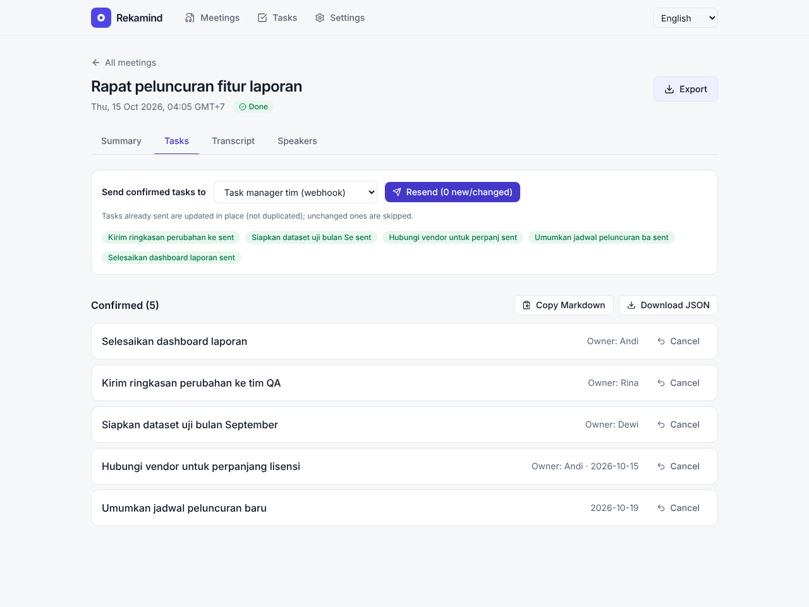

<div align="center">

🌐 **English** · [Bahasa Indonesia](README.id.md)


# Rekamind

**Record meetings. Get a per-speaker transcript, a summary and a task list. Your data stays yours.**

[](https://github.com/handokoaji/rekamind/releases/tag/v0.4.0-beta.8)
[](#-download)
[](LICENSE)

[**Download**](#-download) · [Getting started](#-guide-from-install-to-first-use) · [Features](#-features) · [Team server](#-shared-server-for-teams) · [Troubleshooting](#-troubleshooting)

<br>


</div>

> [!WARNING]
> **This is a beta (0.x) release (latest: v0.4.0-beta.7) for testing, not a final release.** The core features are
> covered by automated tests and have been tried by hand on three Windows PCs (one NVIDIA, one Intel, one AMD), but not
> on many machines. The Linux desktop app has **not** been tested on real hardware. **Do not make Rekamind the
> only copy of a recording that matters.** See the honest list of [beta limitations](#-beta-limitations).

> [!NOTE]
> **Language:** the interface is available in **Indonesian (default) and English**; switch with the language selector in the
> top bar (it is also on the sign-in screen). Most screenshots below show the Indonesian interface. The meeting output
> (summary, decisions, tasks) is currently generated **in Indonesian only**, whichever interface language you pick.

## Why Rekamind

- **Light while recording.** A tiny recorder (Rust) captures the microphone and system audio. No AI model runs during
  the meeting, and the window can be closed.
- **Local first.** Transcription (Whisper) and speaker separation run on your computer. Only the transcript text goes
  to the summary service you choose, and that step is optional.
- **From recording to work.** The result is more than text: decisions, the flow of the meeting, and **tasks** with
  assignee, deadline and an evidence quote you can replay.
- **One person or a whole team.** Install on your own laptop, or on an office server with Google sign-in.
- **Open.** AGPL-3.0-or-later licensed. No accounts, no telemetry, no bundled credentials.

## ✨ Features

<table>
<tr>
<td width="50%" valign="top">

### Record from the desktop
One button or `Ctrl+Alt+R`. Records the microphone and the meeting audio (Zoom, Meet, Teams, ...) as two separate
tracks, so local and remote speakers are easy to tell apart.

</td>
<td width="50%" valign="top">


</td>
</tr>
<tr>
<td width="50%" valign="top">


</td>
<td width="50%" valign="top">

### Or upload a recording
Already have a recording? Upload WAV, MP3 or M4A. The title is filled from the file name.

</td>
</tr>
<tr>
<td width="50%" valign="top">

### Summary, key points, decisions, flow of the meeting
Built from the full transcript. Long meetings are split automatically when the summary service limits request size.

</td>
<td width="50%" valign="top">


</td>
</tr>
<tr>
<td width="50%" valign="top">


</td>
<td width="50%" valign="top">

### Tasks you can verify
Every task carries an assignee, deadline, estimate and an **evidence quote**. You review and confirm first; nothing
is sent anywhere before you decide.

</td>
</tr>
<tr>
<td width="50%" valign="top">

### Per-speaker transcript
Microphone and system audio are separated, speakers are recognised and can be named. A sentence spoken by two people is
cut where the voice changes. If the app merged similar voices, tell it how many people spoke and separate again. Long
transcripts stay smooth (virtualised list). Every recording can be played back from the meeting page.

</td>
<td width="50%" valign="top">


</td>
</tr>
<tr>
<td width="50%" valign="top">


</td>
<td width="50%" valign="top">

### Complete export
One file with summary, decisions, tasks and (optionally) the transcript: **Word (.docx)**, **Markdown** or **JSON**.
Times use your chosen time zone (default WIB, Asia/Jakarta).

</td>
</tr>
<tr>
<td width="50%" valign="top">

### Send tasks to where you work
**GitHub Issues**, **GitLab Issues**, or a signed (HMAC) **webhook** for any task manager. Sending twice does not
create duplicates.

</td>
<td width="50%" valign="top">


</td>
</tr>
</table>

<details>
<summary><b>More views</b> (speakers, all tasks, settings, dark mode, sign-in)</summary>
<br>

| | |
|---|---|
|  <br> **Name the speakers** |  <br> **All tasks across meetings** |
|  <br> **Settings: integrations and time zone** |  <br> **Desktop settings: install the local engine** |
|  <br> **Automatic dark mode** |  <br> **Google sign-in (server mode)** |
|  <br> **English interface** (language selector, top right) | |

</details>

> Screenshots are taken from the real app with sample meeting content (a "demo" engine), not real model output. The
> quality of your transcripts and summaries depends on the audio, the models and the summary service you use.

## 📥 Download

Pick the file for your system:

| System | File | Notes |
|---|---|---|
| **Windows 10/11 (64-bit)** | [`Rekamind-Windows-x64-setup.exe`](https://github.com/handokoaji/rekamind/releases/download/v0.4.0-beta.8/Rekamind-Windows-x64-setup.exe) | `.exe` installer. No admin rights needed. |
| **Linux (64-bit)** | [`Rekamind-Linux-x64.deb`](https://github.com/handokoaji/rekamind/releases/download/v0.4.0-beta.8/Rekamind-Linux-x64.deb) | Debian/Ubuntu and derivatives. |
| Linux, other distros | `Rekamind-Linux-x64.AppImage` | **Not available in beta.2** (the AppImage build failed; fix planned). Use the `.deb`. |

Every file comes with `SHA256SUMS.txt`. All releases: [Releases](https://github.com/handokoaji/rekamind/releases).

**The installers are not code-signed** (beta). Windows SmartScreen will show "Windows protected your PC": click
**More info → Run anyway**. This is normal for apps without a paid certificate; compare the checksum if in doubt.

**Not supported yet:** macOS and ARM machines. **Intel and AMD GPU acceleration is experimental** (see [GPU support](#gpu-support)).

## 🚀 Guide: from install to first use

About 15 minutes, most of it a one-time download.

### Step 1: Install the app

<details open>
<summary><b>Windows</b></summary>

1. Download `Rekamind-Windows-x64-setup.exe` and run it.
2. If SmartScreen appears: **More info → Run anyway**.
3. Follow the installer (Indonesian and English are offered). Rekamind installs for your user only, without admin rights.
4. Open **Rekamind** from the Start menu.

Requirements: 64-bit Windows 10/11. WebView2 ships with Windows 11 and is installed automatically if missing.

</details>

<details>
<summary><b>Linux (Debian / Ubuntu)</b></summary>

```bash
sudo apt install ./Rekamind-Linux-x64.deb      # also pulls in pulseaudio-utils and WebKitGTK
rekamind                                        # or open it from the application menu
```

Recording uses PulseAudio or PipeWire (through `parec`). On PipeWire systems make sure `pipewire-pulse` is installed
(default on Ubuntu 22.10+ and Fedora). For the AppImage: `chmod +x Rekamind-Linux-x64.AppImage`, then run it.

</details>

### Step 2: Try a recording

1. On the **Rapat** (Meetings) page, type a title and click **Mulai merekam** (Start recording), or press `Ctrl+Alt+R` from any app.
2. Hold your meeting as usual. The Rekamind window can be closed; the recorder keeps running in the system tray.
3. When done, press **Stop** (there is a confirmation so you do not stop by accident). The recording is handed to the
   local engine. If **Proses otomatis** (Auto-process) is on in Settings (default), processing starts automatically
   once the engine is installed.

You can already record at this point, even before the AI engine is installed. Recordings wait safely.

> **While recording**, the app shows one calm screen (timer, microphone and speaker levels, **Stop**). The meeting list,
> tasks and settings are hidden on purpose: the processing engine is switched off during a meeting so nothing heavy
> competes with the recording, and it comes back when you stop. If a level bar stays at *Hening* (silent), that source is
> not capturing sound: check the mute switch and input volume of your microphone or headset.

### Step 3: Install the transcription engine (once)

Open **Pengaturan → Mesin transkripsi → Pasang** (Settings → Transcription engine → Install).

| Choice | For | Download size |
|---|---|---|
| **CPU** | Every computer. Slower. | smaller |
| **NVIDIA GPU** | NVIDIA cards with enough VRAM (in our test `large-v3` used 3.3 to 4.2 GB). Much faster. | larger (CUDA libraries) |
| **AMD GPU (Vulkan)**, experimental | Integrated Radeon (tested on the Radeon 860M) and other Vulkan GPUs. Speeds up transcription only; speaker separation stays on the CPU. | small program + ~1 GB model |

There is a progress bar and a cancel button. When it finishes click **Uji mesin** (Test engine); it should say
"Terpasang" (Installed). The speech model downloads when the first meeting is processed (several GB), or click
**Unduh model ... sekarang** (Download model now) to avoid waiting later. The exact download size depends on the
library versions at install time; check your disk space and connection.

**Speaker separation** (who said what) is ticked by default. It needs a free **Hugging Face token**, so the install
buttons stay disabled until you paste one in the notice shown there (it is stored in the system credential store).
Untick the box to install without it: every sound from the computer is then treated as one speaker. When an install
that includes speaker separation finishes, the app switches the setting on for you. Step-by-step guide for the token:
**[docs/API_KEYS.md](docs/API_KEYS.md)**. More detail: [INSTALL.md](docs/INSTALL.md).

#### GPU support

| Hardware | Status |
|---|---|
| **CPU** (any) | Supported. Tested. |
| **NVIDIA GPU** (CUDA) | Supported. Tested on one PC (Windows 11, GTX 1080 Ti). |
| **AMD GPU** (integrated Radeon 680M/780M/860M, e.g. Ryzen 7 7735HS, 8845HS, Ryzen AI 7 350, and other Vulkan-capable GPUs) | **Experimental, via Vulkan (whisper.cpp)** (*Install for AMD GPU (Vulkan)*; from beta.2). A small native program is downloaded on demand; models are the quantised ggml files (~1 GB for large-v3). **Tested on one machine: Ryzen AI 7 350 (Radeon 860M, Windows 11).** There, transcription of a real ~11 minute recording ran on the GPU (about 3 minutes for the computer-audio track, `large-v3` q5_0, ~85% GPU use and ~2.4 GB RAM peak, as read from Task Manager and the process list). **Speaker separation (pyannote) runs on the CPU** on AMD, because the AMD engine installs the CPU build of PyTorch; only transcription is accelerated. Accuracy against the CPU engine and long (30+ minute) meetings have **not** been measured yet. ROCm and DirectML are not used. |
| **Intel GPU** (integrated Arc/Iris Xe, e.g. Core Ultra 7 155H) | **Experimental, via OpenVINO** (*Install for Intel GPU*; from beta.2). Built on the path validated in v1 on a Core Ultra 7 155H. In v2 it installs and runs on that machine according to the maintainer's manual check, but **no measurements (speed, accuracy) have been recorded yet**, so it stays experimental. Large models need several GB of RAM during the one-time conversion; the first meeting is slower because of it. |
| **Intel NPU** | Not supported (evaluated in v1: unreliable on real speech). |

### Step 4: Set up the summary service

Summaries and tasks are produced by a language model through an OpenAI-compatible API. Default: **Groq** (it has a
free tier with usage limits). Under **Pengaturan → Layanan ringkasan** (Settings → Summary service) fill in:

- **API key**: created in your provider account. Stored in Windows Credential Manager or Linux Secret Service, **not**
  in a settings file.
- The address and model are pre-filled for Groq, but **Groq is not required**: any OpenAI-compatible service works
  (OpenAI, OpenRouter, Ollama or another server you run). Examples and how to get a key:
  [docs/API_KEYS.md](docs/API_KEYS.md).

> Privacy: only the **transcript text** is sent to this provider, never audio. If the text must not leave your
> organisation, point it at a model you run yourself, or skip this step (the transcript is still produced).

### Step 5: Process the meeting and review

If **Proses otomatis** is off, open the meeting → **Proses sekarang** (Process now). You will see the status move
(transcription → speakers → summary). Once it reads **Perlu ditinjau** (Needs review):

1. **Ringkasan** (Summary): read the decisions and the flow of the meeting.
2. **Pembicara** (Speakers): name them (Rina, Dewi, ...), then **reprocess** so task assignees link to names.
   Detected the wrong number of people? In the same tab pick the real **Jumlah pembicara** (number of speakers) and
   click **Pisahkan ulang** (Separate again). Similar voices are sometimes merged otherwise.
3. **Task**: check each task (the play button on the evidence quote plays that part of the recording), edit if
   needed, then **Konfirmasi** (Confirm).

At the top of every meeting, **Dengarkan rekaman** (Listen to the recording) plays the computer audio or the
microphone, even when the transcript is empty.

#### What each status means

| Status | When | What to do |
|---|---|---|
| **Sedang merekam** (Recording) | The recording is running | Nothing; stop it first |
| **Siap diproses** (Ready) | Saved, not processed yet | **Proses sekarang**; install the engine first if asked |
| **Menunggu giliran** (Queued) | Waiting for another meeting | Wait; you can close the window |
| **Sedang diproses** (Processing) | Transcript, speakers, summary being made | Wait for the progress bar |
| **Perlu ditinjau** (Needs review) | There are tasks to confirm or reject, or the summary failed | Decide each task; or **Buat ulang ringkasan** |
| **Selesai** (Done) | Nothing left to review (all tasks decided, or none were found) | Export or send tasks |
| **Gagal** (Failed) | Processing hit an error (message in the red card) | Fix the cause, then **Coba lagi** |

### Step 6: Export or send

- **Ekspor** (Export): Word, Markdown or JSON.
- **Send tasks**: add a destination under **Pengaturan → Integrasi** (GitHub, GitLab or webhook), then on the Task tab
  click **Kirim N task** (Send N tasks). Token and permission guide: [INTEGRATIONS.md](docs/INTEGRATIONS.md).

### Time zone

Default **WIB (Asia/Jakarta)**. Change it in **Pengaturan**; deadlines such as "tomorrow" are computed in this zone.

## 🏢 Shared server for teams

For an office: one server, many users, Google sign-in, each person sees only their own meetings (super admins see
all). The desktop app is then switched to **Server terpisah** (Remote server) mode.

**No build needed:** a prebuilt image is published on GHCR. In Portainer paste [`docker-compose.image.yml`](docker-compose.image.yml) (CPU) or [`docker-compose.image-gpu.yml`](docker-compose.image-gpu.yml) (NVIDIA GPU) as a stack (or `docker compose -f <file> up -d`); details in [docs/INSTALL.md](docs/INSTALL.md).

```bash
# or build from source:
cp server/.env.example .env         # fill in PUBLIC_URL, Google OAuth keys and SUPERADMINS
docker compose up -d --build
```

**Google sign-in is implemented** (OIDC authorization code + PKCE) but so far tested only against a mock identity
provider, not real Google. Because the project is open source there are **no bundled Google credentials**: the
installer creates their own OAuth client in Google Cloud Console and supplies the Client ID/Secret through server
environment variables (not through the UI). Full steps, variables and the security model are in
**[docs/AUTH.md](docs/AUTH.md)**. Behind a reverse proxy, see the large-upload notes in
[docs/INSTALL.md](docs/INSTALL.md).

## 🧰 Troubleshooting

| Symptom | Cause and fix |
|---|---|
| SmartScreen blocks the installer | The beta installer is unsigned. **More info → Run anyway**. |
| "Engine not installed" | Finish **Step 3**, then **Uji mesin**. |
| Summary failed but transcript exists | Wrong API key or usage limit hit. The transcript is kept; click **Buat ulang ringkasan** (Regenerate summary) once fixed. |
| The install button is greyed out | Speaker separation is ticked and no Hugging Face token is saved. Paste the token in the notice (guide: [docs/API_KEYS.md](docs/API_KEYS.md)) or untick the box. |
| Only one speaker, or too few | Set **Pengaturan → Pemisah pembicara** to *pyannote* (done automatically after installing with it). If similar voices were merged, set **Jumlah pembicara** in the meeting's Speakers tab and separate again. |
| "Tidak dapat terhubung ke server" while recording | Expected: the local engine is off during a meeting. It returns when you stop. |
| The microphone is silent | The level bar says *Hening*. Check the headset's mute switch, the input volume and **Settings → Sound → Input** in Windows. |
| No meeting audio (microphone only) | Windows: make sure an active output device exists. Linux: install `pulseaudio-utils` / `pipewire-pulse`. |
| `Ctrl+Alt+R` does nothing | Conflicts with another app. Change it in Settings. |
| GPU out of memory | Rekamind automatically falls back to a lighter mode, then to CPU. Close other GPU apps. |
| Slow on an AMD/Intel GPU machine | Check **Uji mesin**: if it shows no GPU, the engine may have fallen back to the CPU (update the graphics driver). Experimental engines may also be slower than expected. |
| AMD: **Uji mesin** says "no Vulkan device; using the CPU" | In v0.4.0-beta.2 this message was wrong on at least the Radeon 860M: the GPU was used for real transcription but the test button could not see it (fixed in the next build). To be sure, look for `whisper.cpp memakai GPU Vulkan: <name>` in `backend\logs\backend.log`. |
| The progress bar barely moves on the AMD engine | Progress is reported per stage (mic, computer audio, speakers, merge), not within a stage, so the bar can sit still for a few minutes on a long recording. Task Manager (GPU, then CPU during speaker separation) shows it is working. |

Backend log lives in the app data folder: `backend\logs\backend.log` (Windows: `%LOCALAPPDATA%\id.rekamind.desktop`;
on Linux the exact location is shown in Settings → backend folder).
When reporting a bug, **do not** attach recordings or API keys. Use the
[issue template](https://github.com/handokoaji/rekamind/issues/new/choose).

## ⚠️ Beta limitations

Stated plainly so you know what is being tested:

- **Installers are unsigned** (Windows will warn you).
- **Linux desktop (tray, global hotkey, audio capture) has not been tested on a real machine.** The backend and UI are
  tested on Linux; the desktop shell is only built in CI.
- **Windows**: tested in detail on one PC (Windows 11, GTX 1080 Ti) and by hand on one Intel Core Ultra 7 155H laptop. Long recordings with the window closed, force-kill during
  recording, Word export in real Microsoft Word, and Credential Manager storage are still being tested manually.
- **GPU**: CPU and NVIDIA CUDA are supported; **Intel GPU is experimental** (OpenVINO; works on one Core Ultra 7 155H by manual check, not measured); **AMD GPU (Vulkan) is experimental**: it ran a real recording on one Ryzen AI 7 350 (Radeon 860M), but accuracy has not been compared with the CPU and speaker separation still runs on the CPU.
- **Real GitHub, GitLab, Google sign-in and S3/MinIO** have only been tested against mock/automated servers.
- **Quality** of transcripts, speaker separation and task extraction has not been measured across many kinds of
  audio. Review the output, especially names and deadlines.
- **Language:** the interface has Indonesian and English; the generated summary and tasks are Indonesian only. Messages coming from the server or the Rust recorder (e.g. some error texts) are not translated yet.
- The old v1 app (Tkinter) lives in git history and tags `v0.1.0` to `v0.3.0`; v2 is not compatible with it.

## 🗺️ Roadmap

Planned for the next releases (**not implemented yet**; listed so you know what to expect, and in no firm order):

- **Intel GPU**: experimental support is implemented (OpenVINO). Next: record real measurements (speed, accuracy) on the Core Ultra 7 155H and drop the "experimental" label once they hold up.
- **AMD GPU**: experimental support is implemented (Vulkan / whisper.cpp) and has run a real recording on the Ryzen AI 7 350 (Radeon 860M). Next: compare accuracy and hallucinations on silence against the CPU engine, test a 30+ minute meeting, and drop the "experimental" label once they hold up. Also planned: speaker separation on the GPU for AMD (today it runs on the CPU), and progress inside a stage instead of only between stages. Older/smaller iGPUs such as the Vega in a Ryzen 5 5600G are not targeted (little benefit expected). **Volunteer testers with other AMD machines welcome** (open an issue).
- **Release hygiene:** signed installers, a working Linux AppImage, and a real-machine test of the Linux desktop app.
- **More interface languages** beyond Indonesian and English, and a choice of output language for summaries and tasks.

Machines without a supported GPU run on the CPU (see [GPU support](#gpu-support)).

## 🛠️ For developers

```bash
pip install -e "server[dev]" && pytest server          # backend
cd web && npm ci && npm test && npm run build          # interface
cd recorder && cargo test                              # Rust recorder
python scripts/build_desktop.py                        # local installer (Windows: nsis, Linux: deb)
```

Architecture: [docs/v2/ARCHITECTURE.md](docs/v2/ARCHITECTURE.md) (Indonesian) · Releasing: [docs/RELEASING.md](docs/RELEASING.md) ·
Contributing: [CONTRIBUTING.md](CONTRIBUTING.md) · Security: [SECURITY.md](SECURITY.md) ·
Changelog: [CHANGELOG.md](CHANGELOG.md)

## 💛 Support the project

Rekamind is free and open source (AGPL-3.0-or-later), made in spare time. If it saves you time and you would like to help keep it going:

<p>
  <a href="https://github.com/sponsors/handokoaji"></a>
  <a href="https://saweria.co/handokoaji"></a>
</p>

🌍 **Anywhere:** GitHub Sponsors. 🇮🇩 **Indonesia** (QRIS, e-wallets): Saweria, or scan:

<a href="https://saweria.co/handokoaji"></a>

Support is entirely optional. A star, a bug report or a pull request helps just as much.

## License

[AGPL-3.0-or-later](LICENSE), Copyright (C) 2026 Rochmad Handoko Aji ([@handokoaji](https://github.com/handokoaji)). If you run a modified Rekamind as a network service, the AGPL requires you to offer the source of your version to that service's users. Releases up to v0.4.0-beta.3 were published under the MIT licence; those copies stay MIT, and AGPL-3.0-or-later applies from v0.4.0-beta.4 onwards. Third-party libraries and models have their own licences (see [THIRD_PARTY_NOTICES.md](THIRD_PARTY_NOTICES.md); e.g. the pyannote models require accepting
terms on Hugging Face).
